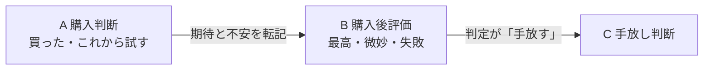
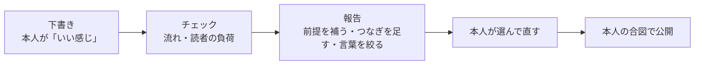

# write-post

「暮らしの技術選定」の記事を、本人の言葉で書くための伴走。型は書き方の補助で、スキーマや lint では縛らない。

## 前提

- 記事は事後報告。何を買った・使った・手放したかと、本人の理由を書く
- 要件表・比較表は必須にしない。出すなら補助まで
- 手元のメモは本人と一緒に読む。質問の材料にするだけで、文章は写さない。記事に入れるのは、本人が入れると言った内容だけ
- 公開のルールは `CLAUDE.md` に従う (下書きはコミットしない、画像のメタデータを残さない、シークレットを入れない)
- コミット・push・PR は、頼まれた時だけ

## 型

- 失敗談も、最高だったという話も B
- 後の記事を出す時、前の記事の末尾に 1 行足す (例: 「その後、手放した」+ `/posts/<slug>/` へのリンク)。`updatedDate` も更新する。前の記事は消さない

### 共通

- `description` に結論を 1 行。ページの先頭にリードとして出るので、先に決める。重い要約にしない
- 本文の冒頭は事実 1〜2 行 (何を・いつ・いくらで・どれだけ使ったか)。結論は繰り返さない
- 見出し 1 つにつき問い 1 つ。答えは 1〜3 文。書けない見出しは消す
- 見出しは `##` から (`#` は題名が使う)。主張で書き、ラベルなしで節の役割が伝わる形にする (例: 「iPad とスマホを 1 台にまとめたい」「画面でかい、ってめっちゃいいじゃん」)。「使ってわかったこと」「まとめ」のようなラベルや、「判定: 〜」のような前置きは使わない
- 下の「見出しと問い」の名前 (困りごと、判定 など) は、聞く問いのラベル。記事の見出しにはそのまま使わない
- 必ず書くのは、冒頭の事実と、型ごとの「必ず書く」1 つだけ
- 末尾に 1 行 (型ごとに違う)
- 選んだ理由の最後に、許容したトレードオフを書く。日付つきの相場を比べるなら、その後に置く

### A 購入判断 (これから試す)

- 題名の例: 〇〇を買った / 〇〇を試す
- `description` の例: 〜に困って買った。〜を 1 か月試す
- 見出しと問い
  1. 困りごと: 買う前、何に困っていた？ いつ、どんな場面で？
  2. 決めたこと: 何を選び、何を選ばなかった？ 決め手は？ (必ず書く)
  3. 試すこと: どうなれば買って良かったと言える？ 期待 2〜3 個、不安 1〜2 個
- 末尾 1 行: 見直す日の目安。書けなくても A は成立する

### B 購入後評価 (最高・微妙・失敗)

- 題名の例: 〇〇を 1 か月使った / 〇〇は失敗だった
- `description` の例: 〜が効いて、続ける / 〜が合わず、手放す
- 見出しと問い
  1. 買った狙い: 何のために買った？ A があれば期待と不安を転記する
  2. 使ってわかったこと: 良かったこと、困ったこと、どちらでもなかったこと。使った場面と期間で。失敗なら困ったことから、最高なら良かったことから
  3. 判定: 続ける・手放す・買い直す、その理由 (必ず書く)
- 末尾 1 行: 次の行動。手放すなら C へ

### C 手放し判断

- 題名の例: 〇〇を手放した
- `description` の例: 〜を使わなくなったので手放した
- 見出しと問い
  1. 経緯: いつ・なぜ買い、どう使っていた？ A・B があればリンクする
  2. 決め手: 手放すと決めたのは、何に気づいた時、何が起きた時？ 使う頻度、代わりの物、置き場所、気持ち (必ず書く)
  3. 手放し方: 手段 (売却・譲渡・処分)、金額、手間
  4. 手放した後: 代わりにどうしている？ 困ったことは？ (なければ「なし」)
- 末尾 1 行: 次に買うなら

## 手順

1. 題材を聞き、型を決める。「買った・これから試す」は A、「使ってみた・N か月・最高・失敗」は B、「手放した・売った・処分した」は C。迷ったら本人に選んでもらう
2. 事実 (何を・いつ・いくらで・どれだけ使ったか) と、型の問いを番号つきでまとめて聞く。答えは短くてよく、飛ばしてよい問いは飛ばしてよいと添える
3. 「必ず書く」の答えが曖昧 (なんとなく、良さそうだった) なら、1 回だけ掘る。それ以外は掘らない
4. 答えから下書きを作る。本人の言い回しを残し、整えすぎない
5. `src/content/posts/_<slug>/index.md` に置く。`pnpm dev` で `/posts/_<slug>/` を開いて読んでもらう
6. 直してもらう。本人が「いい感じ」と言ったら、公開前のチェックをする
7. 本人の合図があった時だけ、公開する

## 文体

- だ・である調。です・ます調にしない
- 太字を使わない。強調は語順と「」で出す
- 主観は「と思う」「と感じる」で角を取る。事実 (価格・日付・型番) は断定する。ただし節の結びは、見つけたことを言い切る (特に想定外: 「予想に反して、…想定外だった。」)。「〜と思う」で濁さない
- 名詞で終わる文は、「だ」を付けず体言止めにする (「…スタンド付きのケース。」)。本人の「…である」は残す
- 目的は「…するため。」で言い切ってよい。「〜が、〜」でつないだ文は、2 つ目が新しい内容なら分ける
- 確かでない数字は本人に聞く。聞けなければ `<!-- TODO: confirm -->` を残し、出す前に消す
- 使った場面と期間で書く。一般論で水増ししない
- 欠点は隠さず、短く書く

## 読者の負荷を下げる

筆者でない読者が、前提知識を補わなくても読めるようにする。

- 同じものは、同じ具体名で呼ぶ (iPad と書いたら、別の所で「手書き端末」と言い換えない)
- 前提は、頼る前に書く (新しい機種がある時は、先に「型落ちを選んだ」と書いてから、新しい機種の話をする)
- 曖昧な言葉は、意味を書く。主語が変わる所は「私は」と書く。同じ語を 2 つの意味で使わない (目的、など)
- 主役の製品の初出は、メーカーと種類を添える (例: 「Galaxy Z Fold6 (Samsung の折りたたみスマホ)」)。専用の用語 (S Pen など) と、後で効く物 (それまで使っていたスマホなど) は、話が最初に必要とする所で出す
- アプリ・サービス・製品 (買う予定だった物も) の初出は、リンクと一言の説明。URL は、共有用の追跡パラメータや `utm_` を外した形にする。`tag=` のない Amazon のリンクは、アフィリエイトではない
- 数字は、誰の・どの条件の数字かと出典を添える (払った額か相場か、容量、モデル)。比べる時は、新しいモデルの数字と並べる。相場には「執筆時点」の日付を付ける
- 本人の習慣には、誤解を招く名前を付けず、やっていることをそのまま書く (「ジャーナリング」ではなく「思考を殴り書きして吐き出す癖」)
- 文脈を足すと、情報量も増える。足すのは本筋に必要なものだけ。短く、1 回。本筋に効かない文脈は削る

## frontmatter

`src/content.config.ts` が正。

- 必須: `title`、`description`、`pubDate` (今日の日付)
- 任意: `updatedDate`、`category` (例: ガジェット・家具・寝具)、`cover` と `coverAlt`、`pr`
- アフィリエイトリンクを入れたら `pr: true`。PR 表記が自動で出る
- フォルダ名 (slug) は英小文字・数字・ハイフン。URL になり、公開後は変えない

## 公開前のチェック

本人が「いい感じ」と言ったら、チェックして報告する。直すのは、本人が選んでから。

- 流れ: 節から節、文から文で、話がつながっているか。主語や接続が飛んでいないか
- 読者の負荷: 筆者でない読者の目で、前提知識が要る所を洗い出す。筆者の背景を渡さない別の読者 (サブエージェント) に、読者設定と本文だけで通し読みさせる
  - 読者設定の例: ソフトウェアエンジニアで、ガジェットを少し知っている。題材の製品は使ったことがない
  - 記録させるのは、前提知識・流れの飛び・語の曖昧さ。場所、疑問、重要度 (高・中・低) を付けさせる。読み終えたら 3 行で要約させ、意図が伝わったかを見る
  - 書き直しの提案と、内容の是非の評価は、させない
- 報告は、前提を補う・つなぎを足す・言葉を絞る、の 3 つにまとめる。高と中を先に出し、低は 1 行にする
- 直したら、足した文脈が重くなっていないかを見る (「読者の負荷を下げる」の最後)

## 公開

本人の合図があった時だけ。

- 画像は同じフォルダに JPEG で置く (HEIC は置けない)。コミットの前に `pnpm photo <フォルダ>` でメタデータを消し、長辺を 2400px に収める
- 別の作業場所 (git worktree) で、最新の `origin/main` から branch を切る。本人の checkout と、動いている開発サーバーには触れない
- 下書きを、`_` なしのフォルダに置く。push した時点で公開される。`pnpm check`・`pnpm test`・`pnpm build` が通る
- コミットは `feat: 記事「<題名>」を足す`。PR を出し、プレビューで表示を確かめてから、マージする
- 本番で、記事ページ・トップ・RSS・サイトマップに載ったかを確かめる
- 手元の下書き (`_` のフォルダ) は、本人の OK があるまで消さない
